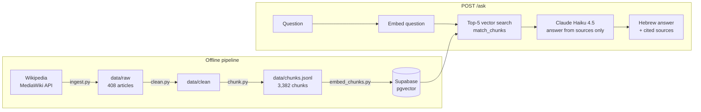

# Hebrew Travel RAG

A retrieval-augmented generation (RAG) service that answers travel and culture questions **in Hebrew**, grounded in **English Wikipedia** articles, with a citation for every claim.

Ask about a city, landmark, museum, festival or natural site. The service finds the most relevant passages and has Claude write an answer that uses only those passages. When the sources don't cover the question, it says so instead of guessing.

> **Status: work in progress.** The ingestion pipeline and baseline retrieval are complete. Evaluation, retrieval experiments and deployment are next (see [Roadmap](#roadmap)).

## How it works



1. **Ingest.** `ingest.py` pulls plain-text extracts from the MediaWiki API: a hand-picked list of cities, landmarks, cuisines, festivals and natural sites, plus pages from categories like *Tourist attractions in Paris* and *Museums in London*. It retries with backoff, skips pages it already saved, and rejects empty pages.
2. **Clean.** Wiki headings (`== History ==`) are converted to Markdown headings, and reference and navigation sections (References, See also, External links, Notes, Bibliography, Further reading) are removed.
3. **Chunk.** Documents are split on section headings. Long sections are split by paragraph, then sentence, then word, with a maximum of 600 tokens and about 50 tokens of overlap. Every chunk keeps its `title`, `url` and `section` for citations.
4. **Embed and index.** Chunks are embedded with OpenAI `text-embedding-3-small` (1536 dimensions) in batches of 100, then upserted into a Supabase Postgres table with pgvector.
5. **Answer.** `/ask` embeds the question, retrieves the 5 nearest chunks, and sends them to Claude as numbered sources. The prompt requires a Hebrew answer, a `[n]` citation next to each factual claim, and the exact fallback sentence `לא מצאתי מידע על זה במקורות` when the sources don't answer the question. In that case no sources are returned.

## Dataset

| | |
|---|---|
| Source | English Wikipedia, via the MediaWiki API (`prop=extracts`, plain text) |
| Articles | 408 |
| Chunks | 3,382 |
| Average chunk size | 336 tokens (`cl100k_base`) |
| Max chunk size / overlap | 600 / ~50 tokens |
| Coverage | European capitals and their museums and attractions, plus selected landmarks, cuisines, festivals and natural sites worldwide |

Chunk validation: 3,382 unique IDs, 0 empty chunks, 0 chunks with missing metadata, 0 chunks over 600 tokens. Full exploration notes and design decisions are in [docs/data-notes.md](docs/data-notes.md).

Wikipedia text is licensed under [CC BY-SA 4.0](https://creativecommons.org/licenses/by-sa/4.0/). Every answer links back to the source articles.

## API

| Method | Path | Description |
|---|---|---|
| GET | `/health` | Liveness check |
| POST | `/ask` | RAG answer in Hebrew with sources. Body: `{"question": "..."}` |
| POST | `/chat` | Plain chat with Claude, no retrieval. Body: `{"text": "..."}` |
| POST | `/chat/stream` | Same as `/chat`, streamed as plain text |
| POST | `/classify` | Structured output: `{category, entities, needs_search}` |

Example:

```bash
curl -X POST http://127.0.0.1:8000/ask \
  -H "Content-Type: application/json" \
  -d '{"question": "What was the Colosseum used for?"}'
```

```json
{
  "answer": "...Hebrew answer with [1] style citations...",
  "sources": [{"title": "Colosseum", "url": "https://en.wikipedia.org/?curid=49603"}]
}
```

Every request is logged as one JSON line with a request ID (also returned in the `X-Request-ID` header), input and output tokens, cost in USD, and latency.

## Running locally

**Requirements:** Python 3.13+, [uv](https://docs.astral.sh/uv/), a Supabase project with the `vector` extension enabled, and API keys for Anthropic and OpenAI.

```bash
uv sync
```

Create a `.env` file in the project root:

```env
ANTHROPIC_API_KEY=...
OPENAI_API_KEY=...
SUPABASE_URL=https://<project>.supabase.co
SUPABASE_KEY=...
```

### Database

The code expects a `chunks` table and a `match_chunks` function. This schema matches what the code reads and writes:

```sql
create extension if not exists vector;

create table public.chunks (
  id text primary key,
  text text not null,
  title text not null,
  url text not null,
  section text,
  embedding vector(1536)
);

create index on public.chunks using hnsw (embedding vector_cosine_ops);

create or replace function public.match_chunks(query_embedding vector(1536), match_count int)
returns table (id text, text text, title text, url text, section text, distance double precision)
language sql stable as $$
  select id, text, title, url, section,
         c.embedding <=> query_embedding as distance
    from public.chunks as c
    order by c.embedding <=> query_embedding
    limit match_count;
$$;
```

### Build the index

Run from the project root:

```bash
uv run python ingest.py
uv run python experiments/clean.py
uv run python experiments/chunk.py
uv run python experiments/embed_chunks.py
```

Embedding all 3,382 chunks with `text-embedding-3-small` costs a few cents.

### Start the server

```bash
uv run fastapi dev main.py
```

Interactive docs are at http://127.0.0.1:8000/docs.

## Testing

```bash
uv run pytest
```

Unit tests replace the Anthropic client with a fake through FastAPI dependency overrides, so they run offline and cost nothing.

`eval/check_ask.py` is an end-to-end smoke check. It sends the 20 questions in `eval/golden.jsonl` to a running server and verifies the response contract: a non-empty answer, every answer has sources, sources have URLs, and a "no information" answer has no sources. The golden set includes single-article questions, multi-article questions and one out-of-scope question.

```bash
uv run python -X utf8 eval/check_ask.py
```

Latest run: 20/20 pass the contract check. One quality note: question 16, a two-part question about Romics and Palazzo Massimo, returned "no information" although both source articles are in the index. This check validates the response format, not answer quality. Quality evaluation is the next milestone.

## Project structure

```
main.py               FastAPI app: endpoints, cost and latency logging
retrieval.py          Question embedding, vector search, prompt construction
settings.py           Typed settings loaded from .env (pydantic-settings)
ingest.py             Wikipedia ingestion via the MediaWiki API
experiments/          Pipeline steps (clean, chunk, embed) and exploration scripts
data/                 raw/ and clean/ articles, chunks.jsonl
eval/                 golden.jsonl and the /ask smoke check
tests/                Unit tests with a fake LLM
docs/data-notes.md    Data exploration and design decisions
```

## Roadmap

- [ ] **Evaluation harness:** grow the golden set to 60–80 questions, including Hebrew questions; measure recall@5 and MRR for retrieval and use a calibrated LLM-as-judge for answer correctness and faithfulness.
- [ ] **Baseline numbers** saved to `results/` so every reported metric is reproducible.
- [ ] **Retrieval experiments:** chunk size, hybrid search (Postgres full-text plus vector, fused with RRF), reranking, and translating Hebrew questions to English before retrieval.
- [ ] **Error analysis** of failed questions, by category.
- [ ] **Deployment:** Docker, Google Cloud Run, Secret Manager, CI/CD with GitHub Actions, and Langfuse tracing.
- [ ] **Web UI:** a minimal right-to-left React page.

## Tech stack

Python · FastAPI · Pydantic · Anthropic Claude (Haiku 4.5) · OpenAI embeddings · Supabase Postgres + pgvector · tiktoken · pytest · uv

## Evaluation baseline

| Configuration | Recall@5 | MRR@5 | Answer accuracy | Avg. API cost/query | Avg. latency |
|---|---:|---:|---:|---:|---:|
| Direct vector search, top 5 | 50.0% | 0.458 | 16.3% (7/43) | $0.002782 | 2,861 ms |

Retrieval metrics cover 60 questions with expected source URLs. Answer accuracy
is the share of answers rated `correct` by the LLM judge among the 43 questions
with reference answers. Cost and latency are averaged over all 62 queries and
cover retrieval and answer generation. The judge runs separately.

[Per-question results](results/baseline_full.jsonl)